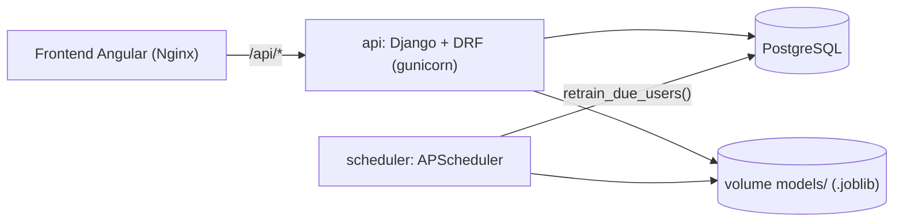
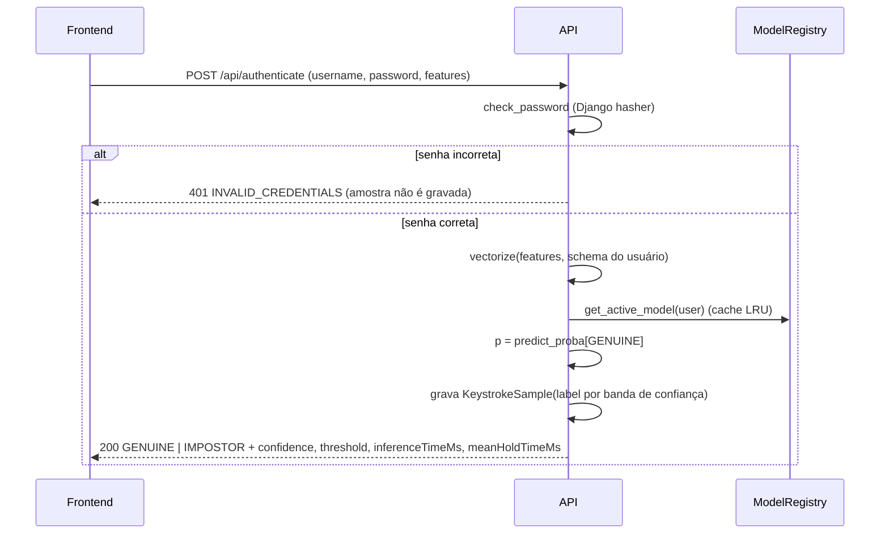

# API de Autenticação por Dinâmica de Digitação (Django + scikit-learn)

Novo projeto `C:\Users\thiag\Repositories\projeto_si_ml_api`, que substitui a Mock API Flask do frontend (`/api/register`, `/api/enrollment`, `/api/authenticate`). Cada usuário tem seu próprio **Random Forest**. O modelo inicial é treinado no enrollment (5 amostras) e retreinado periodicamente com as amostras mais recentes, que vêm das tentativas de login com senha correta, rotuladas pela própria decisão do modelo.

Fontes: `README.md`, `requisitos.md` e `AGENTS.md` do frontend. Não li nenhum código-fonte.

---

## User Review Required

> [!CAUTION]
> **Treinar o modelo inicial "somente com os dados do usuário" é inviável com Random Forest.** O `RandomForestClassifier` é supervisionado. Com uma única classe, `fit` até roda, mas `predict` devolve sempre `GENUINE` e `predict_proba` tem uma coluna só. Qualquer pessoa que acerte a senha seria aceita até o primeiro retreino, e esse retreino nunca teria impostores reais, porque nenhuma tentativa seria rotulada `IMPOSTOR`. É um impasse (deadlock) de cold start.
>
> Alternativas avaliadas para o modelo inicial:
>
> | Opção | Vantagem | Desvantagem |
> |---|---|---|
> | **A. RF + negativos sintéticos** (recomendada) | Mantém RF desde o dia 1. É o mesmo algoritmo do cadastro ao retreino. Funciona com qualquer senha | Os negativos sintéticos são uma aproximação: o modelo aprende "distância ao ritmo do usuário", não impostores reais |
> | **B. One-class no cadastro** (`IsolationForest`, também é um ensemble de árvores do sklearn) e RF a partir do 1º retreino com impostores | Usa só dados do usuário, como você pediu | São dois algoritmos e dois caminhos de inferência. O IsolationForest com 5 amostras é muito instável. Continua dependendo de impostores reais aparecerem |
> | C. RF só com dados do usuário | — | Não funciona (ver acima) |
>
> **O plano segue a opção A.** Os negativos sintéticos entram em todo treino e servem para completar a classe impostora enquanto houver poucas amostras `IMPOSTOR` reais.

> [!WARNING]
> **Auto-rotulagem (feedback loop).** Usar a decisão do próprio modelo como rótulo de treino reforça os erros dele:
> - **Falso aceite** (impostor rotulado `GENUINE`): o impostor passa a fazer parte do "perfil genuíno". Isso é envenenamento (poisoning).
> - **Falso rejeite** (usuário rotulado `IMPOSTOR`): o ritmo do próprio usuário vira exemplo negativo. Na prática esse é o caso **mais frequente**, porque raramente outra pessoa digita a senha correta. A maioria das amostras `IMPOSTOR` tende a ser o próprio usuário num dia ruim, e o modelo fica cada vez mais restritivo.
>
> Mitigações incluídas no plano:
> 1. **Banda de confiança:** só vira rótulo de treino a amostra com `P(genuine) ≥ 0.5 + margem` ou `≤ 0.5 − margem`. As intermediárias ficam gravadas como `UNCERTAIN` e não entram no treino.
> 2. **Teto para impostores reais:** no máximo `RETRAIN_IMPOSTOR_WINDOW` por treino. O restante da classe negativa vem dos sintéticos.
> 3. **Versionamento** de todos os modelos, com o comando `activate_model` para fazer rollback.

> [!IMPORTANT]
> Com 5 amostras o modelo inicial será fraco, seja qual for o algoritmo. Para efeito de comparação, o benchmark CMU usa 200 amostras de treino por sujeito. Os números do primeiro modelo devem ser lidos com isso em mente.

---

## Open Questions

> [!IMPORTANT]
> **1. Contrato HTTP.** Os markdowns só definem o payload de `/api/enrollment` (§5.3). Os de `/api/register` e `/api/authenticate` (request e response, códigos HTTP, nomes dos campos `decision`/`confidence`…) estão abaixo como **proposta**. Posso ler `mock_api/app.py` e `src/app/core/models/*.ts` para copiar o contrato atual? Sem isso, o frontend provavelmente vai precisar de ajustes.

> [!IMPORTANT]
> **2. Dataset CMU.** Você tem o `DSL-StrongPasswordData.csv`? Com ele, gero uma vez as distribuições populacionais (log-normal para H/DD, normal para UD) e o gerador sintético produz negativos com "ritmos humanos" realistas. Sem ele, uso só perturbação das amostras do próprio usuário, que gera negativos mais fáceis de separar.

**3. Agendamento do retreino.** Você pediu os prós e contras de cada opção e outras sugestões:

| Opção | Vantagens | Desvantagens |
|---|---|---|
| **APScheduler em processo dedicado** (container `scheduler`) chamando o mesmo serviço do management command — *recomendada* | Simples, sem broker. Cron/intervalo em Python. `max_instances=1` evita execuções sobrepostas | Agendamento em memória: um job perdido durante um restart não é recuperado (irrelevante para retreino idempotente). Não escala horizontalmente sem lock |
| **Celery + Celery Beat + Redis** | Padrão de mercado, retries, filas, workers escaláveis, monitoramento (Flower) | +2 serviços (Redis, beat) e mais configuração. Exagero para um job por hora |
| **Management command + cron / Agendador de Tarefas do Windows** | Zero dependências, fácil de entender e testar | O agendamento fica fora do repositório e do compose, e depende do SO. Cron em container é desconfortável |
| **`django.tasks` (Django 6.0) + `django-tasks-db` + `django-tasks-scheduler`** | API oficial nova do Django. Backend no próprio PostgreSQL | O framework não tem worker nem agendamento nativos; os dois pacotes são de terceiros e ainda jovens. Exige Django 6.0 (não LTS) |
| **Procrastinate** (fila sobre PostgreSQL, com tarefas periódicas) | Usa o Postgres que já existe. Fila real, retries, locks | Mais uma lib para aprender. Menos popular que Celery |
| **Disparo por evento** (retreinar quando o usuário acumula K amostras novas) | Retreina só quem precisa, logo que há dados | Precisa de fila/worker para não bloquear o login. Pode ser combinado com qualquer opção acima |
| Thread de agendamento dentro do gunicorn | Nenhum serviço extra | **Anti-padrão:** roda uma vez por worker, morre junto com o worker, gera jobs duplicados |

**Proposta:** APScheduler em container próprio, a cada `RETRAIN_INTERVAL_MINUTES`, retreinando **apenas** usuários com `≥ RETRAIN_MIN_NEW_SAMPLES` amostras rotuladas novas desde o último modelo. Isso reaproveita a ideia do disparo por evento sem precisar de fila. Confirma, ou prefere outra?

**4. Versões.** Proponho Python 3.12, **Django 5.2 LTS** + Django REST Framework, scikit-learn 1.7.x e `uv` para dependências. Ok?

---

## Arquitetura





---

## Proposed Changes

### Projeto e infraestrutura

#### [NEW] pyproject.toml / uv.lock
Dependências: `django~=5.2`, `djangorestframework`, `scikit-learn~=1.7`, `numpy`, `joblib`, `psycopg[binary]`, `apscheduler~=3.11`, `gunicorn`, `django-environ`. Dev: `pytest`, `pytest-django`, `ruff`.

#### [NEW] Dockerfile, docker-compose.yml, .env.example
Serviços: `db` (postgres:17, healthcheck), `api` (gunicorn, porta 8000), `scheduler` (`python manage.py run_scheduler`), volume `models_data` compartilhado entre `api` e `scheduler`. Rede `keystroke-network`, a mesma do frontend (RNF09).

#### [NEW] Makefile
Mesmos verbos do frontend (RNF07): `install`, `dev`, `test`, `lint`, `migrate`, `retrain`, `docker-build`, `compose-up`, `compose-down`.

#### [NEW] requisitos.md, AGENTS.md, README.md
Seguem a governança do frontend: `requisitos.md` é a fonte única da verdade e tem histórico de versões. `AGENTS.md` tem as diretrizes para Python/Django e torna os testes obrigatórios.

#### [NEW] config/settings.py, urls.py, wsgi.py
Configuração via env. SQLite quando `DJANGO_TEST=1` (pytest), PostgreSQL nos demais casos. Parâmetros biométricos centralizados:

```python
BIOMETRICS = {
    "ENROLLMENT_SAMPLES": 5,
    "DECISION_THRESHOLD": 0.5,
    "LABEL_CONFIDENCE_MARGIN": 0.2,
    "RETRAIN_INTERVAL_MINUTES": 60,
    "RETRAIN_MIN_NEW_SAMPLES": 5,
    "RETRAIN_GENUINE_WINDOW": 50,
    "RETRAIN_IMPOSTOR_WINDOW": 50,
    "SYNTHETIC_NEGATIVES_MIN": 50,
    "SYNTHETIC_NEGATIVES_RATIO": 5,
    "RANDOM_FOREST": {"n_estimators": 200, "class_weight": "balanced", "random_state": 42, "n_jobs": 1},
    "MODELS_DIR": BASE_DIR / "models_data",
}
```

---

### App `biometrics` — modelos de dados

#### [NEW] biometrics/models.py
Usa o `User` do `django.contrib.auth` para username e senha com hash (PBKDF2), sem reinventar armazenamento de senha.

```python
class BiometricProfile(models.Model):
    user = models.OneToOneField(User, on_delete=models.CASCADE, related_name="biometric_profile")
    feature_names = models.JSONField()  # ordem canônica do vetor, fixada no enrollment
    enrolled_at = models.DateTimeField(auto_now_add=True)

class SampleSource(models.TextChoices):
    ENROLLMENT = "ENROLLMENT"
    LOGIN = "LOGIN"

class SampleLabel(models.TextChoices):
    GENUINE = "GENUINE"
    IMPOSTOR = "IMPOSTOR"
    UNCERTAIN = "UNCERTAIN"  # dentro da banda de confiança; fora do treino

class KeystrokeSample(models.Model):
    user = models.ForeignKey(User, on_delete=models.CASCADE, related_name="keystroke_samples")
    features = models.JSONField()
    raw_timings = models.JSONField(null=True)
    source = models.CharField(choices=SampleSource.choices, max_length=16)
    label = models.CharField(choices=SampleLabel.choices, max_length=16)
    genuine_probability = models.FloatField(null=True)
    classified_by = models.ForeignKey("TrainedModel", null=True, on_delete=models.SET_NULL)
    created_at = models.DateTimeField(auto_now_add=True, db_index=True)

class TrainingTrigger(models.TextChoices):
    ENROLLMENT = "ENROLLMENT"
    SCHEDULED = "SCHEDULED"
    MANUAL = "MANUAL"

class TrainedModel(models.Model):
    user = models.ForeignKey(User, on_delete=models.CASCADE, related_name="trained_models")
    version = models.PositiveIntegerField()
    file_path = models.CharField(max_length=500)
    sha256 = models.CharField(max_length=64)
    sklearn_version = models.CharField(max_length=20)
    trigger = models.CharField(choices=TrainingTrigger.choices, max_length=16)
    training_stats = models.JSONField()  # genuine, real_impostors, synthetic, oob_score
    is_active = models.BooleanField(default=False)
    created_at = models.DateTimeField(auto_now_add=True)

    class Meta:
        constraints = [
            models.UniqueConstraint(fields=["user", "version"], name="unique_model_version"),
            models.UniqueConstraint(fields=["user"], condition=models.Q(is_active=True), name="single_active_model"),
        ]
```

#### [NEW] biometrics/admin.py
Registro dos três modelos para inspeção pelo Django Admin.

---

### App `biometrics` — núcleo de ML (`biometrics/ml/`, sem dependência de HTTP)

#### [NEW] ml/features.py
- `validate_sample(features)`: chaves no padrão `H.*`, `DD.*`, `UD.*`; valores finitos; `H, DD ∈ (0, 5]` s; `UD ∈ [-5, 5]` s (UD negativo é válido quando há sobreposição de teclas).
- `build_schema(samples)`: todas as amostras do enrollment precisam ter **o mesmo conjunto de chaves**, e a ordem canônica é a ordenação lexicográfica. Os nomes são tratados como opacos, então a API aceita tanto `H.t` (exemplo do §5.3) quanto `H.t.0` (RF09). Os dois documentos divergem nesse ponto; vale corrigir no frontend.
- `vectorize(features, schema) -> np.ndarray`: rejeita chaves faltantes ou extras (400).
- `mean_hold_time_ms(features)`.

O Random Forest é invariante à escala, então não há `StandardScaler`.

#### [NEW] ml/synthetic.py
`generate_negatives(genuine: np.ndarray, schema, count, rng) -> np.ndarray`, combinando 50/50:
1. **Perturbação:** `x · tempo · exp(N(0, σ))`, com `tempo ~ U(0.55, 0.8) ∪ U(1.25, 1.9)` (ritmo global diferente) e ruído por feature. A amostra é descartada se cair a menos de `k` desvios (Manhattan escalada) da média genuína.
2. **População** (se houver `population_priors.json`): cada feature é sorteada da distribuição do seu tipo (H/DD log-normal, UD normal), ajustada ao dataset CMU.

#### [NEW] ml/training.py
```python
def train_user_model(genuine: np.ndarray, real_impostors: np.ndarray, schema: list[str], rng) -> TrainingResult:
    synthetic_count = max(
        settings.BIOMETRICS["SYNTHETIC_NEGATIVES_MIN"],
        settings.BIOMETRICS["SYNTHETIC_NEGATIVES_RATIO"] * len(genuine),
    ) - len(real_impostors)
    negatives = np.vstack([real_impostors, generate_negatives(genuine, schema, max(synthetic_count, 0), rng)])
    features = np.vstack([genuine, negatives])
    labels = np.array([1] * len(genuine) + [0] * len(negatives))
    classifier = RandomForestClassifier(**settings.BIOMETRICS["RANDOM_FOREST"], oob_score=True)
    classifier.fit(features, labels)
    return TrainingResult(classifier, stats={...})
```

#### [NEW] ml/registry.py
- `save_model(user, result, trigger)`: grava `models_data/<user_id>/v<version>.joblib`, calcula o sha256 e, numa transação, cria o `TrainedModel` e troca o `is_active`.
- `load_model(trained_model)`: `lru_cache` por `(id, sha256)`. Confere o hash antes do `joblib.load`, porque o formato é pickle e só arquivos gerados pela própria API podem ser carregados. Avisa se a `sklearn_version` for diferente da instalada.

#### [NEW] ml/inference.py
`classify(model, vector, threshold) -> Classification(decision, genuine_probability, inference_time_ms)`, cronometrado com `time.perf_counter()`.

---

### App `biometrics` — serviços e API

#### [NEW] biometrics/services.py
Orquestra o fluxo. As views só serializam.
- `register_user(username, password)`
- `enroll_user(username, samples)`: valida `samplesCount == len(samples) == ENROLLMENT_SAMPLES` e se o usuário ainda não fez enrollment; grava as amostras (`ENROLLMENT`, `GENUINE`); treina v1 **de forma síncrona** (RF com cerca de 30 linhas leva milissegundos).
- `authenticate_user(username, password, features, raw_timings)`
- `label_for(probability)`: aplica a banda de confiança.
- `retrain_due_users(now)` e `retrain_user(user, trigger)`: usam as `RETRAIN_GENUINE_WINDOW` amostras `GENUINE` mais recentes (com o tempo, as de enrollment saem da janela, que é o comportamento de "mais recentes" pedido) e as `RETRAIN_IMPOSTOR_WINDOW` `IMPOSTOR` mais recentes. `UNCERTAIN` não entra. A seleção usa `select_for_update(skip_locked=True)` no perfil, para que execuções concorrentes não retreinem o mesmo usuário.

#### [NEW] biometrics/serializers.py, views.py, urls.py
DRF `APIView`, com `ScopedRateThrottle` em `authenticate` contra força bruta.

| Método | Rota | Request | Response |
|---|---|---|---|
| GET | `/api/health` | — | `200 {status, database}` |
| POST | `/api/register` | `{username, password}` *(proposta)* | `201 {username}` · `409` se já existe |
| POST | `/api/enrollment` | payload §5.3 | `201 {username, modelVersion, featureCount}` · `400` validação · `404` usuário · `409` já tem enrollment |
| POST | `/api/authenticate` | `{username, password, features, rawTimings?}` *(proposta)* | `200 {decision: GENUINE\|IMPOSTOR, confidence, threshold, inferenceTimeMs, meanHoldTimeMs, modelVersion, message}` · `401 {decision: INVALID_CREDENTIALS}` · `409` sem enrollment · `400` schema divergente |

Os campos de resposta cobrem os dados da tela bloqueada (RF15): Grau de Confiança, Limiar, Tempo de Inferência e Hold Médio. Para usuário inexistente a resposta é a mesma de senha errada (`401`), para não permitir enumeração de usuários.

---

### Comandos de gerenciamento

#### [NEW] management/commands/retrain_models.py
`retrain_models [--username X] [--force]`: execução manual ou via cron; chama `retrain_due_users` / `retrain_user`.

#### [NEW] management/commands/run_scheduler.py
`BlockingScheduler` do APScheduler com `IntervalTrigger(minutes=RETRAIN_INTERVAL_MINUTES)`, `max_instances=1`, `coalesce=True`. Chama `close_old_connections()` antes de cada execução.

#### [NEW] management/commands/activate_model.py
`activate_model <username> <version>`: rollback.

#### [NEW] management/commands/fit_population_priors.py
Lê o CSV do CMU e gera `biometrics/data/population_priors.json` (só se a pergunta 2 for respondida com "sim").

---

### Fora do escopo (frontend)
Apontar `proxy.conf.json` e o Nginx do frontend para `api:8000` e atualizar o `requisitos.md` do frontend (RNF08/RNF09). Isso depende da pergunta 1 e fica para uma tarefa separada.

---

## Verification Plan

### Automated Tests
`pytest` + `pytest-django` (SQLite), em `tests/`:
- `test_features.py`: validação de faixas, schema inconsistente entre amostras, chaves faltantes/extras, nomes com sufixo `.0`.
- `test_synthetic.py`: forma, valores finitos, H/DD positivos, distância mínima até a média genuína, reprodutibilidade com seed.
- `test_training.py`: o modelo tem 2 classes; amostras genuínas recebem `P(genuine)` alta; ritmo 2× mais lento recebe probabilidade baixa.
- `test_registry.py`: versão incremental, um único ativo, recusa de arquivo com hash adulterado, cache.
- `test_api.py`: fluxo completo register → enrollment → authenticate (GENUINE, IMPOSTOR, INVALID_CREDENTIALS), códigos 400/401/404/409, gravação das amostras com o rótulo correto e `UNCERTAIN` na banda.
- `test_retrain.py`: janelas de amostras, `UNCERTAIN` excluído, usuários sem amostras novas ignorados, nova versão ativada, `--force`, rollback.

```powershell
cd C:\Users\thiag\Repositories\projeto_si_ml_api
uv run pytest
uv run ruff check .
```

### Manual Verification
1. `make compose-up` e depois `GET http://localhost:8000/api/health`.
2. Fluxo com `Invoke-RestMethod`, usando o payload do §5.3 e uma tentativa com tempos multiplicados por 2 (espera-se `IMPOSTOR`).
3. `docker compose exec api python manage.py retrain_models --force` e conferir a v2 no Django Admin.
4. (Após a pergunta 1) apontar o frontend para a API e repetir o fluxo pela interface.
